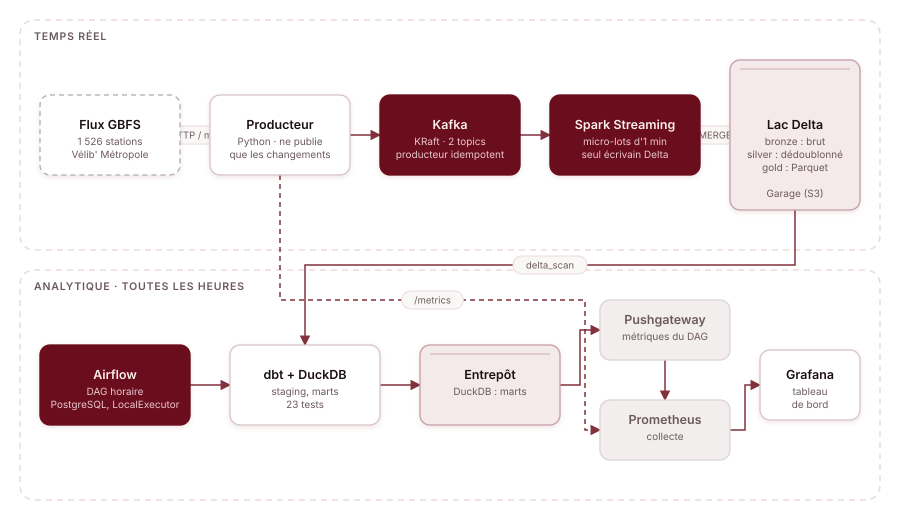

# Vélib' Data Pipeline

**Suivre en direct les 1 526 stations Vélib' de Paris et de sa métropole, avec les outils qu'utilisent les équipes data des grandes entreprises.**

Toutes les minutes, Vélib' publie l'état de chaque station : combien de vélos
mécaniques, combien d'électriques, combien de places libres. Ce projet capte ce
flux, le range, le nettoie, le transforme en indicateurs utiles (quelles
stations sont souvent vides, quels arrondissements manquent de vélos) et
surveille que tout fonctionne. Toute la chaîne tourne sur un seul ordinateur
avec Docker, et son équivalent sur AWS est décrit en Terraform.



## Le chemin d'une donnée

1. **Collecte.** Un petit programme Python interroge le flux Vélib' chaque
   minute et ne transmet que les stations dont l'état a changé.
2. **Transport.** **Kafka** reçoit ces messages et les garde sept jours : si
   une étape plante, rien n'est perdu, on reprend où on en était.
3. **Rangement.** **Spark** lit Kafka en continu et écrit dans un lac de
   données au format **Delta Lake**, en deux couches :
   - *bronze* : les messages bruts, tels qu'ils sont arrivés ;
   - *silver* : des relevés propres, typés, sans doublons.
4. **Indicateurs.** **dbt** transforme ces relevés en tables prêtes à
   l'analyse : disponibilité par heure, stations saturées, état du réseau par
   arrondissement. Chaque table est testée.
5. **Orchestration.** **Airflow** lance tout ça chaque heure : il vérifie que
   les données arrivent, exécute dbt, publie les indicateurs et en exporte une
   copie.
6. **Surveillance.** **Prometheus** et **Grafana** affichent le débit, les
   erreurs, le retard éventuel et l'état du réseau.

## Ce que le vrai flux m'a appris

Travailler sur une vraie source plutôt que sur des données inventées a fait
apparaître des problèmes qu'aucune démo n'aurait montrés :

- **Le serveur Vélib' refuse les programmes anonymes.** Il faut se présenter
  avec un User-Agent, et en caractères ASCII : un accent dans le mien faisait
  échouer chaque collecte.
- **Le flux se répète.** Par moments, il renvoie un état plus ancien pour une
  centaine de stations. Sur les 70 premières minutes : 5 794 messages pour
  3 212 relevés réellement différents. La couche silver fait le tri.
- **Certaines stations sont muettes.** 21 n'ont rien envoyé depuis plus d'une
  semaine, une depuis 2021. Il faut les écarter des moyennes.
- **Les codes de station cachent l'arrondissement**, mais les arrondissements
  1 à 9 ont un code à 4 chiffres et non 5. Ma première règle rangeait tout le
  centre de Paris en banlieue. Un test vérifie maintenant que les 20
  arrondissements sont bien là.
- **Le stockage n'est pas un détail.** MinIO, l'outil habituel pour un stockage
  type S3 en local, ne publie plus ses images. J'ai d'abord essayé SeaweedFS,
  incompatible avec Spark, puis adopté **Garage**. Le traitement n'a pas changé
  d'une ligne : seul le bloc de stockage a bougé.

Le dossier complet est dans [docs/velib-data-pipeline.pdf](docs/velib-data-pipeline.pdf).

## L'essayer

Il faut Docker et environ 8 Go de mémoire pour Docker.

```bash
cp .env.example .env       # les commentaires expliquent comment générer les secrets
docker compose up -d --build
```

| Interface | Adresse |
|---|---|
| Airflow | http://localhost:8080 (utilisateur `admin`) |
| Grafana | http://localhost:3000 |
| Kafka UI | `docker compose --profile debug up -d kafka-ui`, puis http://localhost:8081 |

Les premières données apparaissent après quelques minutes ; Airflow tourne à
chaque heure.

## Quelques choix, expliqués

- **Une seule écriture par table.** Seul Spark écrit dans le lac, y compris
  pour l'entretien des fichiers. Deux programmes qui écrivent au même endroit
  finissent par se gêner.
- **Rejouer sans doublonner.** On peut relire tout Kafka depuis le début : la
  couche silver ne gardera chaque relevé qu'une fois.
- **Prêt pour le cloud.** En local, Garage remplace S3 ; Kafka, Spark et le
  catalogue ont leurs équivalents AWS dans `infra/aws/` (S3, MSK, EMR, Glue).

## Organisation du dépôt

```
producer/       la collecte (Python)
spark/          le traitement en continu
dbt/            les indicateurs et leurs tests
airflow/        l'orchestration
monitoring/     Prometheus et le tableau de bord Grafana
infra/          le stockage local (Garage) et la version AWS (Terraform)
```

## Tests

L'intégration continue vérifie chaque brique séparément : la collecte, les
transformations Spark, les 23 tests dbt (sur un vrai échantillon du flux), le
chargement des tâches Airflow et la configuration Terraform.

---

Code sous licence MIT, par Sassi Benalouache ([Falakion](https://falakion.com)).
Données : Vélib' Métropole, flux GBFS en open data.
